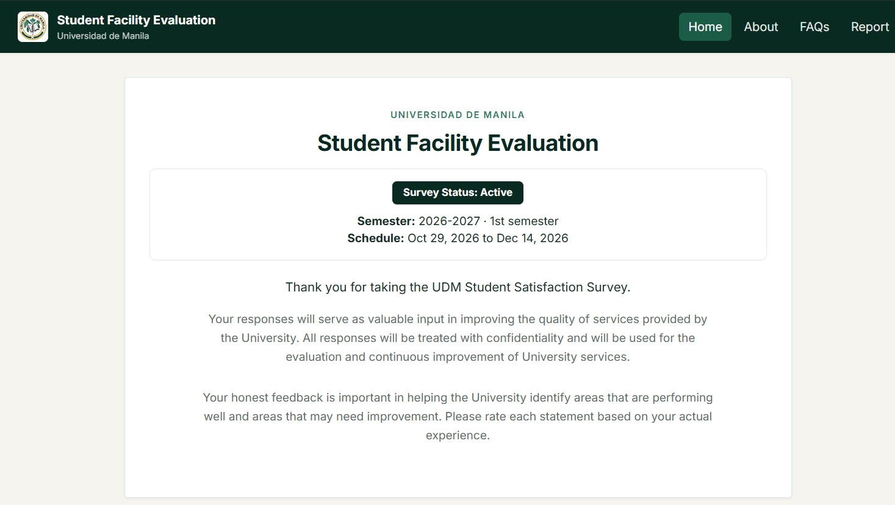

# UDM QA System



## About the system

The UDM QA System helps Universidad de Manila's Quality Assurance office collect student evaluations of campus facilities and services, identify recurring concerns, and track what the university does in response. It supports the workflow from opening a survey to reviewing feedback and documenting a completed improvement action.

- **Students** complete a scheduled survey, rate the service areas that apply to them, leave optional comments, and receive a protected submission receipt. They can also report difficulties with the survey.
- **QA staff** review ratings and written feedback in dashboards and reports. The system groups comments by sentiment and topic and supports English, Filipino, and Taglish feedback.
- **QA administrators and directors** manage survey cycles and staff access, review intervention suggestions based on recurring feedback, and track actions from draft through approval and completion. The system also supports audit history, backups, and recovery.

## About this demo

A fresh installation creates the service-area catalog and the first staff account. The survey, student, and QA history tables start empty. The demo's classifiers train on invented examples, so their predictions may differ from those in the university installation.


## Start the backend

Use Python 3.12 and a local MySQL or MariaDB server. The default database name is `udm_qa_demo`. Use a new database dedicated to this copy.

```powershell
cd backend
python -m venv .venv
.venv/Scripts/python.exe -m pip install -r requirements.txt
Copy-Item .env.example .env
```

Edit `backend/.env` with your local database connection and set `JWT_SECRET` to a new random secret. Set the first staff login in the terminal before starting the backend.

```powershell
$env:QA_ADMIN_USER = 'demo-admin'
$env:QA_ADMIN_PASSWORD = Read-Host 'Initial admin password' -MaskInput
.venv/Scripts/python.exe -m ml.train_demo
.venv/Scripts/python.exe -m uvicorn app.main:app --port 8000
```

Use PowerShell 7 for `Read-Host -MaskInput`. In Windows PowerShell 5.1, set the initial credentials through your process or host environment. The backend Docker image builds the demo models automatically. For a hosted instance, configure a dedicated database, a random JWT secret, a strong initial admin password, and the frontend CORS origin using `backend/.env.production.example`.

## Start the frontend

From the repository root in a second terminal, use Node.js 22.12 or later.

```powershell
cd frontend
npm ci
npm run dev
```

Open `http://localhost:5173`. Sign in at `/qa/login`, create an academic cycle, set its dates, and activate the survey. Use fictional identities and feedback when testing the student workflow.

## Verify locally

From `frontend`, run `npm run build` and `node --test src/*.test.js`. After training the demo models, run `.venv/Scripts/python.exe -m unittest verify_operations verify_sql_retrieval verify_no_substantive verify_comment_accounting` from `backend`. Those backend tests use isolated SQLite fixtures.

Keep filled-in environment files, student records, training corpora, database exports, and backups outside Git.
